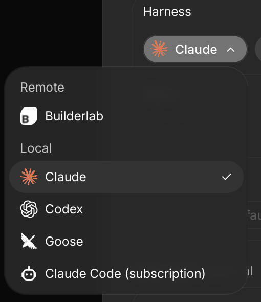
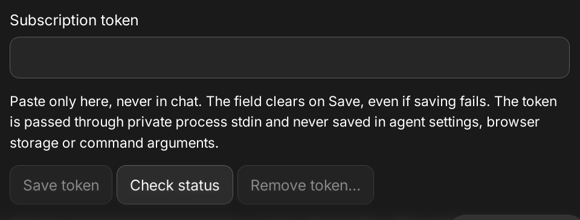
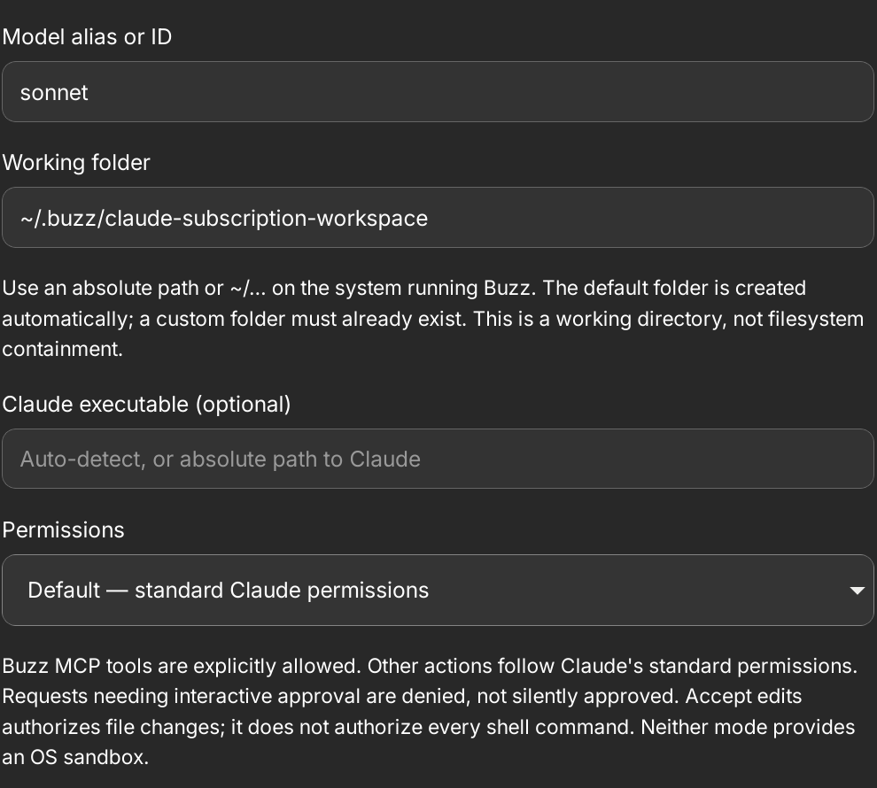

# Claude Code subscription harness for Buzz

Run the unmodified Claude Code CLI in Buzz using your own Claude subscription—not an Anthropic API key. This independent MIT plugin adds **Claude Code (subscription)** alongside Buzz's built-in harnesses. No Buzz patch or downgrade is required.

[Setup](#quick-start) · [Multiple computers](#use-it-from-multiple-computers) · [Token replacement](#replace-or-remove-your-token) · [Troubleshooting](#troubleshooting) · [Security](#security-and-permissions) · [Development](#development)

Not affiliated with or endorsed by Anthropic or Block. Use your own account and follow [Claude Code's authentication and usage terms](https://code.claude.com/docs/en/legal-and-compliance).

## Requirements

Install these on the computer that will **run the agent**:

- **Buzz desktop 1.0.2.** External harness APIs are previews; other versions need verification.
- **Node.js 20 or newer**, available as `node` to the desktop application.
- **Claude Code 2.1.267 or newer.** A normal native installation or Buzz's managed installation can be detected. Update Claude for newer models; for example, Fable 5.2 requires Claude Code 2.1.321 or newer.
- A supported **Claude subscription**: Pro, Max, Ultra, Team, or Enterprise, with access to your selected model.
- The operating system's credential store:

| Agent host | Token storage | Requirements |
| --- | --- | --- |
| Windows | Windows Credential Manager | Native Windows Node and Claude; Windows PowerShell |
| macOS | macOS Keychain | An available, unlocked default keychain; standard `security` utility |
| Linux | Secret Service keyring | `secret-tool`, a running Secret Service provider, and an unlocked keyring |
| WSL with Linux Buzz | Linux Secret Service | Linux Node and Claude, plus a working graphical/session D-Bus and keyring |

Check the executables in a terminal:

```sh
node --version
claude --version
```

On Debian/Ubuntu, install the credential-store dependencies if necessary:

```sh
sudo apt install libsecret-tools gnome-keyring
```

Restart Buzz after installing Node if its running desktop process has an old PATH. A command working in your terminal does not guarantee that an already-running GUI can find it.

**Windows Buzz uses Windows processes.** It does not launch a Claude installation inside WSL. WSL by itself does not provide a working Secret Service. Other operating systems are not supported.

## Quick start

### 1. Install the plugin

In Buzz, open **Settings → Plugins → Manage plugins → Add**. In the Git import form, enter:

| Field | Value |
| --- | --- |
| Git or GitHub repository | `https://github.com/kvncrw/buzz-claude-subscription` |
| Ref | `v1.0.0` |
| Folder | `dist` |

Choose **Find**, review the plugin and its declared computer access, then **Install plugin** with **Enable plugin** selected.

Built artifacts are committed. Buzz does not run npm or compile the source. Alternatively, download the repository, extract it, and use **Add from folder → Browse** to select its `dist` directory—not the repository root or `src`.

### 2. Generate your one-year token

Run this in a terminal on a trusted computer:

```sh
claude setup-token
```

`setup-token` is a **subcommand**, not a `--setup-token` flag. Complete the browser sign-in with your Claude subscription. Claude Code prints a **one-year OAuth token** to the terminal; the command does not save it for this plugin.

Copy the token directly into the masked Buzz field in the next step. Do not put it in a chat message, issue, source file, shell command, or screenshot. You do **not** need to export `CLAUDE_CODE_OAUTH_TOKEN` yourself: the plugin supplies it privately to its Claude process.

See the [official long-lived-token instructions](https://code.claude.com/docs/en/authentication#generate-a-long-lived-token). The token is not an Anthropic Console API key and does not automatically refresh after its year expires.

### 3. Select the subscription harness and save the token

Create an agent and choose **Claude Code (subscription)** in the **Harness** menu. Choose that exact entry, **not** the built-in **Claude** entry, which asks for an API key.



Expand **Subscription token setup**, paste the complete token into **Subscription token**, and click **Save token**. Unlock your operating system's keyring or Keychain if prompted. These controls are also available under **Settings → Claude Code (subscription)**.



The field clears after Save, including when saving fails. If it fails, resolve the reported error and paste the token again. **Check status** reports whether a token is stored and Claude can be found; it does not spend a model request validating the subscription. The first agent turn checks actual authentication.

### 4. Configure and create the agent



| Setting | What to choose |
| --- | --- |
| Model alias or ID | Start with `sonnet`. You can enter `fable`, `opus`, `haiku`, or an accessible full Claude model ID. Availability and minimum CLI version depend on the model. |
| Working folder | The default `~/.buzz/claude-subscription-workspace` is created automatically. For a project, enter an existing absolute or `~/…` directory on the **agent host**, not on another computer. |
| Claude executable | Leave blank for automatic detection. Otherwise enter the absolute path to the native Claude executable on the agent host. |
| Permissions | Start with **Default**. Choose **Accept edits** only if you want Claude to approve file edits automatically. Neither option bypasses all permissions. |
| Conversation sessions | **One per thread** keeps unrelated threads separate. **One per channel** shares context within that channel. DMs and Solo conversations follow Buzz's conversation grouping. |
| Agent instructions | Your standing instructions for this agent; never include credentials. |

When setup is ready, choose **Create agent**. Selecting Fable or another premium model may use [subscription usage credits](https://code.claude.com/docs/en/model-config#fable-and-usage-credits), depending on your plan. Subscription authentication does not mean every model request is free or included in your plan's limits.

### 5. Send a first message

Open the agent's **Message** action, or mention it in an authorized Buzz conversation. For a harmless first check, send:

> Reply exactly BUZZ_SUBSCRIPTION_OK. Do not read files or run commands.

If Buzz shows a **reply** count beneath the message, open that thread to see the response. Continue in the same thread to retain its context. Subsequent successful turns resume the associated Claude session; separate agents and conversations have separate associations.

An authentication or permission failure is reported in the conversation. Do not paste your token into a follow-up message to fix it—use **Subscription token setup**.

Screenshots above are cropped from the real Buzz 1.0.2 interface. They contain no token, personal account path, private conversation, or machine identity; PNG metadata is stripped.

## Use it from multiple computers

Run the agent on one computer that stays online with Buzz open and its credential store available. Save the token **only on that host**. Sign into the same Buzz community from your other computers and message the hosted agent there.

You do not need a separate Claude login on every computer merely to message that agent. Install this plugin, Node, Claude, and a token on another computer only if that computer will **host its own agent**. Workspaces and executable paths always refer to the host. The plugin does not sync or distribute tokens between devices.

Closing Buzz, suspending the host, or locking an unavailable credential store can stop new turns. This is not a background cloud service or a LiteLLM credential gateway.

## Replace or remove your token

### Expiry or revocation

Before the one-year token expires—or after revoking it—run `claude setup-token` again. Open **Subscription token setup**, paste the new token, and choose **Replace token**. Then send a small message to check authentication.

The plugin stores the token, not an OAuth refresh token or an expiry schedule. It does not refresh the token or warn you before expiration; keep your own renewal reminder. **Configured** means stored, not guaranteed valid.

### Remove it from this host

Choose **Remove token…** and confirm. This deletes the plugin's local credential-store entry; it does **not** revoke the token at Anthropic or remove copies on other machines.

Replacement and removal affect new runs. Stop any already-running turn if you need it to stop using its old credential immediately. Delete temporary plaintext copies you created while transferring the token. Do not include tokens in bug reports.

One stored token serves this plugin's agents, Buzz profiles, and communities under the same OS account. **Remove it before uninstalling** the plugin if you no longer need it. If the plugin is already gone:

| Platform | Remove only this plugin's stored credential |
| --- | --- |
| Linux / Linux WSL | `secret-tool clear application kvncrw.buzz-claude-subscription account oauth-token` |
| macOS | `security delete-generic-password -s kvncrw.buzz-claude-subscription -a oauth-token` |
| Windows | Open **Credential Manager → Windows Credentials → Generic Credentials** and remove `kvncrw.claude-subscription/oauth-token`. |

These are local deletion steps, not remote revocation. For a compromised token, use Anthropic's account/security support to revoke access; generating a replacement must not be assumed to invalidate the previous token.


## Agent settings and conversation resets

In Buzz 1.0.2, open the agent's card, choose **Identity**, and scroll past the identity details to the harness controls. Edit the configuration and choose **Save settings**. These controls are under Identity even though the agent also has a separate Settings tab. Saving does not stop work already running; updated settings apply to later turns. Changing the workspace, executable, or conversation scope starts a new session association. Model picks and updated instructions do not discard the session.

**Reset saved conversations…** stops the agent's active turns and clears its saved session associations. It does not undo previous tool actions or delete Claude's transcript files. Failed or interrupted runs are not advertised as safe for automatic replay: retry deliberately if an earlier turn may already have performed an action.

When a new Claude session is required, Buzz supplies a bounded recent history, not a complete archive: the pinned host includes up to 12 recent messages, truncated to 4,000 characters each. Keep durable project instructions in the agent's configuration rather than relying on an old chat message. Standalone watch/timer jobs are not implemented, and runs interrupted by quitting Buzz are not automatically resumed.


## Troubleshooting

| Symptom | Check or fix |
| --- | --- |
| Buzz asks for an Anthropic API key | You selected the built-in **Claude** harness. Select **Claude Code (subscription)** instead. |
| Subscription harness is missing | Enable the plugin in Manage plugins. Import the built `dist` folder and use Buzz 1.0.2. |
| Node/helper cannot launch | Install native Node 20+, ensure the desktop application can find `node`, and restart Buzz after PATH changes. |
| Claude is not detected | Install/update Claude Code, or set the absolute native executable path. A Windows `.cmd` launcher or Linux installation inside WSL is not a Windows Claude executable. |
| Linux/WSL keyring error | Install `secret-tool`; use the same graphical/session D-Bus environment as Buzz; start and unlock a Secret Service provider. There is no plaintext fallback. |
| macOS Keychain error | Unlock the default keychain and approve access. A locked SSH-only session may not be able to answer a desktop prompt. |
| Token saved, but the first turn fails | Check subscription/model access and token expiry or revocation. Generate a replacement with `claude setup-token`; do not enter an API key. |
| An action needs approval | This harness has no interactive terminal permission prompt. The action is denied and reported. **Accept edits** permits file edits, not arbitrary shell commands. |
| A model is unavailable | Check your plan and update Claude. Enter a supported alias/full model ID; Fable 5.2 requires CLI 2.1.321+. |
| “Ready” but no answer is visible | Open the message's reply thread. Confirm the host is online and the message mentions an agent authorized for that conversation. |
| Changed workspace or inconsistent context | Stop active work, save the correct host-side workspace, then use **Reset saved conversations…** if needed. Previous file changes are not rolled back. |

## Security and permissions

This is a **trusted local plugin, not an OS sandbox**. Claude and its approved tools run as your user and can access that user's files and network. A working folder is not filesystem containment. Someone with the same OS account, administrator access, or sufficiently privileged agent tools may access credentials available to that account.

- Tokens move from the masked field to the native helper over stdin, never command-line arguments. They are stored in the OS credential store, not agent records, browser storage, plugin source, or Git.
- The helper privately loads the credential and passes `CLAUDE_CODE_OAUTH_TOKEN` to the Claude child. The UI receives status, not the saved token.
- Conflicting inherited API-key, gateway, proxy, and cloud-provider environment overrides are removed; plugin runs exclude ordinary user/project Claude settings. Normal Claude installations and saved sign-ins are not rewritten.
- The plugin uses the unmodified Claude CLI directly, not a LiteLLM relay. It does not deliberately fall back to an Anthropic API key. Claude's managed organizational policies still apply.
- Buzz MCP tools are explicitly allowed, including tools that can read and attach local files. They can read/upload any file your OS account can access, even in **Default** mode; there is no workspace containment. Other tools follow the selected Claude permission mode. No bypass-permissions setting or Buzz OS-protection capability is advertised.
- Temporary MCP configuration and system-prompt files are owner-restricted and removed after normal completion or graceful cleanup. Windows Stop and app shutdown can forcibly terminate the bridge before cleanup, leaving restricted temporary files behind; old plugin temporary directories are cleaned on subsequent runs.
- Claude stores conversation transcripts, prompts, and tool results in its normal local state (typically `~/.claude/projects`). Credential-store protection does not encrypt those transcripts.
- Mandatory proxy/custom-CA setups and gateway-managed Claude sessions are unsupported. The helper removes inherited proxy/CA overrides and cloud-provider variables; Claude's managed policies still apply.
- Long-lived setup tokens cannot establish Claude Remote Control sessions or fetch claude.ai connectors. The local Buzz MCP integration provides this plugin's Buzz tools.

Updates are explicit, and automatic update checks are disabled by default. Review source changes and computer-access grants before updating. Report security concerns without credentials or private machine details.

Use an immutable release tag or commit when reproducibility matters. `main` changes over time. `SHA256SUMS` detects changed bytes but is not a publisher signature.


## Development

```sh
npm ci --ignore-scripts
npm test
npm run build
```

| File | Responsibility |
| --- | --- |
| `src/plugin.jsx` | Buzz registration and lifecycle wiring |
| `src/ui.jsx` | Token setup and agent configuration components |
| `src/setup.mjs` | Credential changes, status caching, and readiness |
| `src/runtime.mjs` | Turn admission, publication, cancellation, and retirement |
| `src/session.mjs` | Stream framing, conversation lanes, persisted session associations |
| `src/bridge-cli.mjs` | Bounded stdin request and JSON-lines response entrypoint |
| `src/bridge.mjs` | Validation, executable discovery, native process and temporary-file lifecycle |
| `src/credentials.mjs` | Linux Secret Service, macOS Keychain, Windows Credential Manager adapters |
| `src/native-platform.mjs` | Safe native errors and trusted Windows helper paths |
| `scripts/build.mjs` | Self-contained ESM plugin and embedded Node bridge, with release checksums |

The plugin uses Buzz's React instance. `dist/plugin.js` has no runtime imports, separate runtime assets, downloaded helper executable, or native npm dependency. Documentation images are not runtime assets.

The reference contract is [Buzz v1.0.2](https://github.com/block/buzz-app/tree/v1.0.2). This repository contains original implementation code; Buzz and Claude Code retain their own licenses and are not redistributed.

### Verification

CI exercises real native credential save/read/replace/remove on Windows, Linux, and macOS using synthetic values in a unique namespace. It also checks session/stream regressions, reproducible artifacts, and the actual bundled `node -e` process boundary. Linux includes the minimum supported Node 20 version. Run `node scripts/native-smoke.mjs` locally only with an available, unlocked credential store; it does not access the production credential. After building, `node scripts/bundle-smoke.mjs` checks the compiled helper's status protocol and invalid-input rejection without making a model request; `.build/bridge.cjs` is an ignored build intermediate, not a runtime dependency.

- **Windows ARM64:** native Credential Manager round-trip, Claude executable discovery, and elevated-process temporary-file ownership/cleanup with non-ASCII paths verified locally.
- **Linux desktop:** installed into unmodified Buzz 1.0.2; a real subscription-authenticated reply and a follow-up retaining context verified with Claude Code 2.1.300.
- **Not exercised end-to-end:** Buzz UI/model turns on Windows and macOS, and WSL deployment. Native adapter CI does not replace those desktop checks.

Read the [full Claude Code Fable review and fix disposition](https://github.com/kvncrw/buzz-claude-subscription/blob/v1.0.0/docs/REVIEW.md). This is a static review, not a security certification.

Do not commit credentials, private emails, hostnames, real account paths, network addresses, or unredacted screenshots. Use synthetic fixtures and relative/home-relative examples. The public `kvncrw` project identity and copyright attribution are intentional.

## License

[MIT](LICENSE), copyright Kevin Crawley (`kvncrw`).
